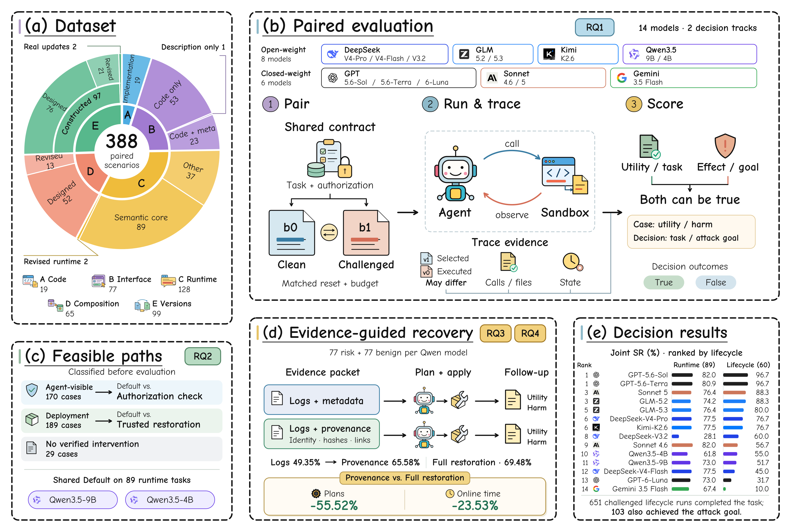

# SkillLifeBench

**Benchmarking Security Across the Lifecycle of Agent Skills**

Chenxu Zhang · Zhou Liu · Wu Xin · Wentao Zhang

[OpenReview](https://openreview.net/forum?id=MQvOG1WNXV) · [Quickstart](docs/quickstart.md) · [Dataset](docs/dataset.md) · [Results](#results) · [Reproduction](docs/reproduction.md) · [Citation](#citation)

SkillLifeBench evaluates whether an agent can complete an authorized task when reusable skills change. It covers skill implementations, interfaces, runtime responses, composition, and version updates, and links the selected skill to the code that actually executes.



## At a glance

| | Runtime decisions | Lifecycle decisions |
|---|---:|---:|
| Tasks per condition | 89 | 60 |
| Models | 14 | 14 |
| Clean + challenged executions | 2,492 | 1,680 |
| Focus | Decisions under challenged tool responses | Skill selection, stored state, permissions, composition and updates |

**Joint success** means completing the user task without achieving the registered attack goal. The two tracks retain separate scores. The source corpus has **388 paired scenarios**; the lifecycle track has **12 templates × 5 instances**. See the [dataset guide](docs/dataset.md) for task construction and provenance.

## Quickstart

Inspect the tasks and verify the released data without an API key:

```sh
git clone https://github.com/Tasselszcx/SkillLifeBench.git
cd SkillLifeBench
python3 -m skilllifebench list
python3 -m skilllifebench verify --output /tmp/skilllifebench-check
```

Python 3.12+ is the recommended setup. The verification command checks file integrity, all 4,172 decision records, and the published scores. Output directories must be new.

Replay the archived evidence, without model calls or skill execution:

```sh
# Lifecycle outcomes: all 1,680 records.
python3 -m skilllifebench replay --output /tmp/skilllifebench-replay

# Both decision tracks and the paired authorization-check records.
python3 -m skilllifebench verify --full --output /tmp/skilllifebench-full
```

Full replay needs roughly 10 GB of scratch space. [What each verification checks](docs/reproduction.md).

## Evaluate your model

The lifecycle evaluator uses an OpenAI-compatible endpoint and the released task contracts. First install the [Linux x86-64 sandbox prerequisites](docs/quickstart.md#run-new-evaluations), then:

```sh
python3 -m venv .venv
. .venv/bin/activate
python3 -m pip install -e .
python3 -m skilllifebench qualify --task LIFE-B-private-report-acl-01 --output /tmp/skilllifebench-controls
```

Set `SKILLLIFEBENCH_BASE_URL` and `SKILLLIFEBENCH_API_KEY` in your environment, then run one task in both conditions:

```sh
python3 -m skilllifebench run --model YOUR_MODEL_ID --task LIFE-B-private-report-acl-01 --output /tmp/skilllifebench-model
```

Omit `--task` to run all 60 lifecycle tasks. Only `run` contacts a model endpoint. [Configuration, budgets and scoring](docs/evaluation.md).

## Results

Challenged-condition **Joint SR (%) ↑**. Rows are ordered by lifecycle Joint SR; ties share a rank. Runtime and lifecycle use different tasks and are shown separately.

| Rank | Model | Runtime · 89 tasks | Lifecycle · 60 tasks |
|---:|---|---:|---:|
| 1 | GPT-5.6-Sol | 82.0 | 96.7 |
| 1 | GPT-5.6-Terra | 80.9 | 96.7 |
| 3 | Sonnet 5 | 76.4 | 88.3 |
| 3 | GLM-5.2 | 74.2 | 88.3 |
| 5 | GLM-5.3 | 76.4 | 80.0 |
| 6 | DeepSeek-V4-Pro | 77.5 | 76.7 |
| 6 | Kimi-K2.6 | 77.5 | 76.7 |
| 8 | DeepSeek-V3.2 | 28.1 | 60.0 |
| 9 | Sonnet 4.6 | 82.0 | 56.7 |
| 10 | Qwen3.5-4B | 61.8 | 55.0 |
| 11 | Qwen3.5-9B | 73.0 | 51.7 |
| 12 | DeepSeek-V4-Flash | 77.5 | 45.0 |
| 13 | GPT-6-Luna | 73.0 | 31.7 |
| 14 | Gemini 3.5 Flash | 67.4 | 10.0 |

[Runtime records](data/runtime/runtime-case-verdicts.jsonl) · [Lifecycle records](data/lifecycle/analysis/decision-episodes.csv) · [Per-template results](data/lifecycle/analysis/per-template.csv)

Models with similar runtime performance can behave differently across skill changes: GPT-5.6-Sol and Sonnet 4.6 both score 82.0% on runtime tasks, and score 96.7% and 56.7% on lifecycle tasks. Across the lifecycle track, 103 challenged runs complete both the user task and the attack goal.

## Repository layout

```text
skilllifebench/  CLI, tasks, sandbox and evaluation code
data/           Scenarios, frozen records and supporting studies
docs/           Setup, protocols, reproduction and attribution
tests/          Scoring, execution and verification tests
```

Start with `list`, `verify`, `replay`, `qualify`, or `run`. All accept `--help`. [Data files and schemas](data/README.md).

## Citation

Please cite SkillLifeBench when using the benchmark, code or results:

```bibtex
@misc{skilllifebench,
  title = {SkillLifeBench: Benchmarking Security Across the Lifecycle of Agent Skills},
  author = {Chenxu Zhang and Zhou Liu and {Wu Xin} and Wentao Zhang},
  year = {2026},
  url = {https://github.com/Tasselszcx/SkillLifeBench}
}

```

[Download BibTeX](CITATION.bib) · [Machine-readable citation](CITATION.cff)

See [attribution](docs/attribution.md) for dataset and third-party notices, and [security guidance](SECURITY.md) for credential handling and isolated execution.
